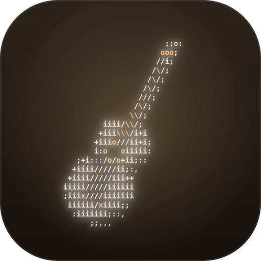
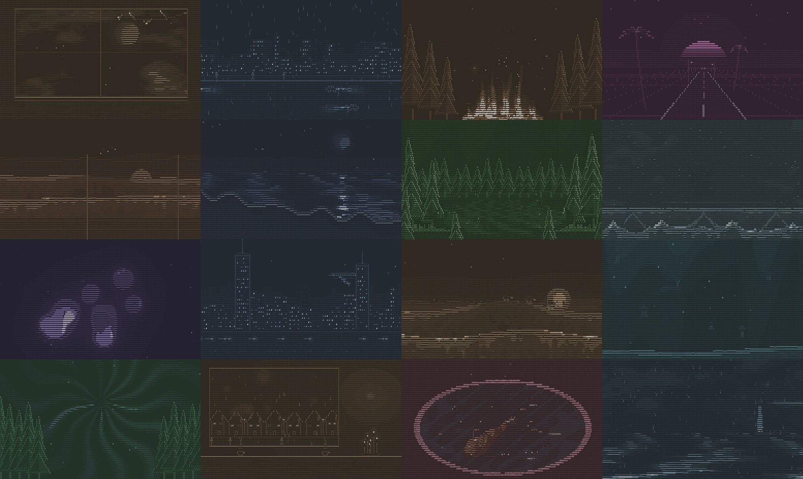

<div align="center">



# Studyloom

**Endless generative focus music, with a living ASCII world behind it.**

Sixteen hand-built scenes drawn entirely out of text characters, each one reacting to the music, with a built-in focus timer.

[](../../releases/latest)




<sub>Still frames rendered headlessly and brightened for the README. In the app everything moves, and it looks richer.</sub>

</div>

## Features

- **Endless generative music** made live with Web Audio, with moods, modes and soft beats that never loop.
- **16 animated ASCII scenes.** Every scene is drawn in text characters on a canvas, one colour family per scene.
- **Seamless motion.** Scenes never restart or jump; clouds drift, fires crackle and fish swim.
- **Focus timer.** A Pomodoro / countdown timer with a record of focus time kept by day.
- **A guitar in the middle of the player,** also drawn in text characters.
- Runs offline, with no accounts and no tracking.

## The scenes

| | | | |
|---|---|---|---|
| **Quiet study**<br>Night window, drifting clouds | **Rainy evening**<br>Street level, headlight beams | **Campfire**<br>Pine treeline and fireflies | **Night drive**<br>Synthwave road |
| **Train window**<br>Hills, poles, birds | **Moonlit tide**<br>Storm-style waves, shooting stars | **Forest grove**<br>Pine valley and pond | **Snowy peaks**<br>One great mountain, blizzard |
| **Starfield drift**<br>Lava-lamp nebula | **City lights**<br>Towers, traffic, distant airliner | **Desert dusk**<br>Camel caravan | **Deep sea**<br>A circling shark |
| **Northern lights**<br>Blue spiral aurora | **Café corner**<br>Cottages, steam, candles | **Zen garden**<br>Koi pond, tadpoles | **Stormy lighthouse**<br>Lightning and spray |

Individual frames are in [`docs/scenes`](docs/scenes).

## Download

Grab the latest build from the [**Releases**](../../releases/latest) page.

| Platform | File |
|---|---|
| Windows 10/11 (64-bit) | `Studyloom Setup <version>.exe` |
| macOS, Apple Silicon | `Studyloom-<version>-arm64.dmg` |
| macOS, Intel | `Studyloom-<version>-x64.dmg` |

Installers are built automatically by GitHub Actions whenever a `v*` tag is pushed.

> **The builds are not code-signed**, so your OS will warn you the first time.
> - **Windows:** "Windows protected your PC" → **More info → Run anyway**.
> - **macOS:** open the `.dmg`, drag Studyloom to Applications, then right-click it → **Open**. If macOS says the app is damaged, run `xattr -cr /Applications/Studyloom.app`.

## Run from source

```bash
npm install
npm start
```

## Build installers

```bash
npm run dist:mac        # .dmg + .zip (run on a Mac)
npm run dist:win        # Windows installer (run on Windows)
```

## How it works

- `main.js`: the Electron shell.
- `index.html`: the player, scenes list, music engine, guitar and focus timer, all in one file.
- `ascii.js`: the ASCII scene engine, which is also embedded in `index.html`. Each scene is a stack of layers with `init`, `tick` and `paint`, coloured by a per-scene theme.

## License

MIT
